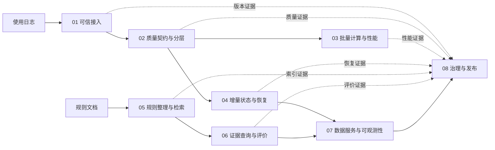

# 课程导论与课前准备

本章是八次实验的共同入口，不新增第九次实验。应用导论安排在实验 01 的前 45—50 分钟；Python 依赖、模型下载和系统重启在课前完成，课堂只做短健康检查。

## 1. 先看最终要解决的问题

校园已经有一套公共计算资源服务，每次使用会产生一条日志，规则文件说明配额、维护时间和可见范围。昨天管理员发现用量上升，需要知道各服务处理了多少请求、失败了多少；学生想查询自己能看到的公开规则，并要求回答指出原文；维护者刚更新规则，准备发布服务，却发现统计、索引和测试报告可能不是同一版本。

八次实验共同建设“校园公共计算资源使用分析与规则查询平台”。AI 推理日志只是已有数字服务的一类合成工作负载，采集这些数据不需要运行模型；课程也不开发预约前台。设备预约、图书借用和机房开放可作为综合项目迁移题，但若真正更换业务字段，必须重新验证数据契约和全链结果。

开课时先展示三个最终产物。下面是**教学格式示意**，数值和标识是为了说明字段，不是本机运行证据；学生实验时必须替换为自己的真实结果：

```json
{"stats":{"date":"2026-09-11","requests":20000,"failed":142}}
{"answer":"配额耗尽后，请等待下一周期或联系管理员。","citations":[{"doc_id":"quota-policy","version":3,"chunk_id":"quota-03"}]}
{"release":"REJECT","reason":"服务索引版本与当前规则清单不一致"}
```

第一条让管理员看到昨日用量和失败数；第二条让学生直接回到规则原文；第三条让维护者先修复版本问题再发布。学生随后回答五个问题：

1. 收到的日志是否完整，坏数据和重复数据怎样处理？
2. 数据增大时如何计算，新增、重发和中断后如何恢复？
3. 如何只检索当前、可见且可追踪的规则？
4. 如何判断该回答、该拒绝，回答是否有原文支持？
5. 如何通过 HTTP 提供能力，并在发布前核对版本、权限和故障证据？

## 2. 两条主线怎样汇合



实验 03 向后提供性能判断和批处理证据，不是实验 05 的文件输入。实验 05 的业务内容来自规则文档；当前轻量实现把实验 04 统计快照的哈希写进索引清单，只作跨主线版本标记，不把统计内容送入检索。实验 04 的增量汇总与实验 06 的证据查询在实验 07 汇合；实验 08 检查各层证据能否共同支持发布。

| 实验 | 核心问题 | 技术职责 | 可见输出 |
|---|---|---|---|
| 01 | 文件经过接口后还是同一份吗？ | 对象接口、地址、内容身份 | 原始文件、对象键、往返哈希 |
| 02 | 坏值和重复会怎样带偏统计？ | 契约、隔离、去重、分层 | 质量守恒、Parquet、汇总 |
| 03 | 什么时候值得并行？ | worker、分区、局部合并、性能对照 | 进程、聚合、计时证据 |
| 04 | 重发和中断后怎样继续？ | 事务、检查点、幂等、重放 | 状态库、恢复证据、增量汇总 |
| 05 | 怎样找当前且可见的规则？ | 版本、权限、词法与语义检索 | Top-K 来源、两种索引证据 |
| 06 | 怎样回答、拒答并评价？ | 原文摘录、Qwen 生成、引用、dev/test | 摘录/生成回答、评价表 |
| 07 | 其他程序怎样调用？ | HTTP、版本化缓存、延迟与错误 | `/stats`、`/ask`、负载记录 |
| 08 | 当前版本可以发布吗？ | 血缘、权限、故障和发布门禁 | 失败原因、恢复复验、发布说明 |

本课用 Moto、Parquet/DuckDB、Dask LocalCluster、SQLite 和 FastAPI 观察成熟机制，但不把本机实现冒充公有云、跨机集群、流平台或生产认证。技术名词的位置由应用需求决定，而不是为了堆叠工具。

课程路线对应的是成熟架构机制，教学工具负责把机制缩小到一台电脑上观察：

| 应用需要 | 课程中的可观察机制 | 生产架构中的对应依据 |
|---|---|---|
| 原始数据、清洗数据和分析结果不要混在一起 | raw/silver/gold 分层与质量清单 | [Microsoft Fabric Medallion Architecture](https://learn.microsoft.com/en-us/fabric/onelake/onelake-medallion-lakehouse-architecture)把原始、清洗和分析分层作为设计模式 |
| 存储、专用计算和治理需要协同 | 对象接口、Parquet、批处理、版本和权限分别承担职责 | [AWS Modern Data Architecture](https://docs.aws.amazon.com/wellarchitected/latest/analytics-lens/modern-data-architecture.html)说明数据湖、专用存储、数据移动和治理的协同关系 |
| 中断后恢复时不能凭感觉重算 | 状态、检查点、重放与幂等输出 | [Apache Flink Fault Tolerance](https://nightlies.apache.org/flink/flink-docs-stable/docs/learn-flink/fault_tolerance/)说明有状态计算、checkpoint 和重放；端到端结果仍取决于 source 与 sink |

这些来源支持分层、状态恢复和治理机制的合理性，不代表其作者认可本课这组轻量工具，也不把 Flink 列为学生必装软件。

## 3. 两类 AI 都由学生自愿选择

“用 AI 助手帮助学习”和“在系统中运行模型”是两回事。学生可以不用 AI 助手；使用者可询问配置、报错和代码含义，但要自行核实并简短披露用途，未使用者无需提交空白记录。评分依据运行证据、关键逻辑和解释，不依据是否使用 AI。

实验 05 保留 BGE 语义检索完整实践，实验 06 保留本地 Qwen 证据生成完整实践；同时提供关键词检索和确定式原文摘录基础路径。任一路径均可完成必达目标并获得满分，不运行模型无需写 `SKIP`，也无需分析教师模型输出。在线付费 API 完全由学生本人决定，课程不要求购买、不指定服务，密钥不得提交。

| 位置 | 模型路径中的技术作用 | 同分基础路径 |
|---|---|---|
| 实验 05 | BGE 分别编码规则片段和问题，再按向量相似度排序。例如希望“额度用完了怎么办”靠近“配额耗尽后的处理办法” | 任选一种关键词排序，做查询改写、误检/漏检和来源核验 |
| 实验 06 | Qwen 只根据实验 05 找到的规则证据生成自然语言解释，再检查引用和原文支持 | 确定式摘录，比较单/多来源选择和失败变式 |

表中的问题只是说明两个模型的职责，不是已验证的具体查询命中。BGE 是检索编码器，Qwen 是生成模型；两者不能互相替代，也都不是必须用 ChatGPT 写代码。

模型生成得不漂亮不自动扣除调用链得分，但学生必须识别无依据扩写、遗漏和引用错误。数据正确性、权限与发布门禁不能降低：证据不支持的回答应拒绝发布或回退到原文摘录。

## 4. 课前环境与国内下载

### 4.1 基础与模型依赖

课程包放在短路径目录，在项目根目录建立 `.venv`。清华 PyPI 镜像采用一次性参数，不改学生的全局配置：

```powershell
$coursePyPI = 'https://mirrors.tuna.tsinghua.edu.cn/pypi/web/simple'
py -3.12 -m venv .venv
.\.venv\Scripts\python.exe -m pip install --index-url $coursePyPI -r .\requirements.lock.txt
```

选择本地模型实践的学生再安装 `requirements-models.lock.txt`。锁文件固定包版本但没有文件哈希，不能据此声称制品已做哈希锁定。Ollama 安装程序由学校分发从官方来源取得并校验的副本；`OLLAMA_HOST` 是服务地址，`OLLAMA_MODELS` 是本地目录，目前没有课程已验收的官方国内 registry 镜像变量。

```powershell
.\.venv\Scripts\python.exe -m pip install --index-url $coursePyPI -r .\requirements-models.lock.txt
.\.venv\Scripts\python.exe -m pip check
```

网络不稳定时，教师可用同一清华源课前建立 wheelhouse 与 manifest；学生先核对 manifest，再用 `--no-index --find-links .\wheelhouse` 安装。完整教师命令见《教师实施与验收指南》。

### 4.2 默认模型组合

实验 05 固定使用 `BAAI/bge-small-zh-v1.5`、固定 revision、本地目录和 manifest。实验 06 的默认教学规格为 Qwen3.5 0.8B Q8_0；课程从 [ModelScope 的 ggml-org 转换仓库](https://modelscope.cn/models/ggml-org/Qwen3.5-0.8B-GGUF)固定 revision 获取 `Qwen3.5-0.8B-Q8_0.gguf`，完整文件约 0.83 GB。准备脚本和 `models/generation-manifest.json` 统一核对来源、字节数与 SHA-256，导入后的本地 tag 为 `bdp-qwen35:0.8b-q8_0`。

该 GGUF 是 ggml-org 的社区转换，不是 Qwen 官方 GGUF，也不是 Ollama 官方 registry tag 的同一制品，不能复用官方 digest。BGE 与 GGUF 的默认准备脚本均从 ModelScope 固定 revision 下载并逐文件或整文件校验；已验证的下载链只允许 `modelscope.cn` 和指定国内 CDN。校内离线包作为网络故障备用，并与在线路径使用同一冻结文件和校验值。`HF_ENDPOINT` 只影响 Hugging Face Hub、不影响 Ollama；先前 HF-Mirror 路径会重定向境外站点，不能作为本课默认国内路径。

```powershell
.\.venv\Scripts\python.exe .\scripts\prepare_embedding.py
.\.venv\Scripts\python.exe .\scripts\prepare_generation.py prepare
.\.venv\Scripts\python.exe .\scripts\prepare_embedding.py --verify-only
.\.venv\Scripts\python.exe .\scripts\prepare_generation.py verify
.\.venv\Scripts\python.exe .\scripts\prepare_generation.py import-ollama
$env:BDP_EMBED_MODEL = (Resolve-Path .\models\bge-small-zh-v1.5).Path
$env:HF_HUB_OFFLINE = '1'
$env:BDP_OLLAMA_MODEL = 'bdp-qwen35:0.8b-q8_0'
```

已有课程离线材料时，BGE 可执行 `prepare_embedding.py --local-source <目录>`，GGUF 可执行 `prepare_generation.py prepare --local-file <文件路径>`；之后仍须执行各自校验和 Ollama 导入。同名 Safetensors 不能直接当 GGUF；其他来源的 BGE 只作备用，迁移前须核对文件一致性。

### 4.3 默认规格与自愿挑战

默认组合只验收固定 BGE 与课程导入的 Qwen3.5 0.8B Q8_0。本机 CPU 已完成默认制品准备、实验 05 编码/检索和实验 06 生成/引用流程验证。发布验收仍须在真实 16 GB、无 GPU 参考环境中确认整机峰值，并证明使用默认 0.8B 即可完成 01—08 全部必做流程、不要求学生升级模型；这项 16 GB 物理机认证尚未完成，不能把现有大内存机器结果外推为所有 16 GB 电脑都能跑通。[`qwen3:0.6b-q4_K_M`](https://ollama.com/library/qwen3:0.6b-q4_K_M)（官方包约 523 MB）仅保留旧流程历史参考，不重新测试；它的速度和效果需要同机对照才可比较。

默认运行配置为关闭思考、CPU、上下文 2048、最多生成 256 token、2 个 CPU 线程、请求超时 120 秒、temperature 0；具体值由 `coursekit/model_config.py` 统一读取。短上下文用于本课短规则证据，不把模型支持的更长上限直接搬进 16 GB 教学配置。

| CPU 环境 | 建议生成模型与参考包大小 | 说明 |
|---|---|---|
| 16 GB | `bdp-qwen35:0.8b-q8_0`，课程文件约 0.83 GB；`qwen3.5:2b-q4_K_M`，官方包约 1.9 GB | 前者为默认；后者自愿挑战 |
| 24—32 GB | `qwen3.5:4b-q4_K_M`，约 3.4 GB；`qwen3.5:9b-q4_K_M`，约 6.6 GB | 4B 为进阶，9B 为高档挑战 |

| 可用显存 | 建议系统内存 | 学生自愿挑战参考 |
|---:|---:|---|
| 4 GB | 16 GB | `qwen3.5:2b-q4_K_M`（1.9 GB） |
| 6 GB | 16 GB | `qwen3.5:4b-q4_K_M`（3.4 GB） |
| 8 GB | 16 GB | 4B Q4；`qwen3.5:9b-q4_K_M`（6.6 GB）为边界挑战 |
| 12 GB | 24 GB | 9B Q4 |
| 16 GB | 32 GB | `qwen3.5:9b-q8_0`（11 GB） |
| 24 GB | 32—64 GB | `qwen3.5:27b-q4_K_M`（17 GB） |

模型 tag 与参考包大小来自 [Ollama Qwen3.5 tags](https://ollama.com/library/qwen3.5/tags)；课程默认的社区 GGUF 与官方 1.0 GB tag 制品身份不同。表中是推荐挑战档位，不是硬件绝对上限或兼容认证。默认配置使用 CPU；学生探索 GPU 时可显式设置 `BDP_OLLAMA_NUM_GPU`，并自行检查实际运行设备和显存，挑战型号不列入教师发布验收。没有同机数据时不写 Token/s 或速度倍数；在相同硬件和运行设置下，大模型通常更慢、内存需求更高，复杂指令和证据整合能力预期更强但不保证本课程每题更好。Q8 与 Q4 是精度、内存和速度取舍，不是新的能力等级。

## 5. 实验 01 的 180 分钟

| 时间 | 内容 |
|---|---|
| 0—30 分钟 | 三类用户故事，先看最终响应、来源和失败单 |
| 30—50 分钟 | 双主线、两个对象和八实验地图 |
| 50—70 分钟 | 路径、对象键、endpoint、哈希小例子 |
| 70—95 分钟 | 身份、生成数据、查看事件；选择模型路径者只做短健康检查 |
| 95—125 分钟 | Moto S3 往返与核对 |
| 125—150 分钟 | 对象键局部改动 |
| 150—165 分钟 | 错误 endpoint 与恢复 |
| 165—180 分钟 | 能力边界、交接实验 02、出口题 |

模型下载不进入课堂时间。具体比例仍需一次学生试教校准。
