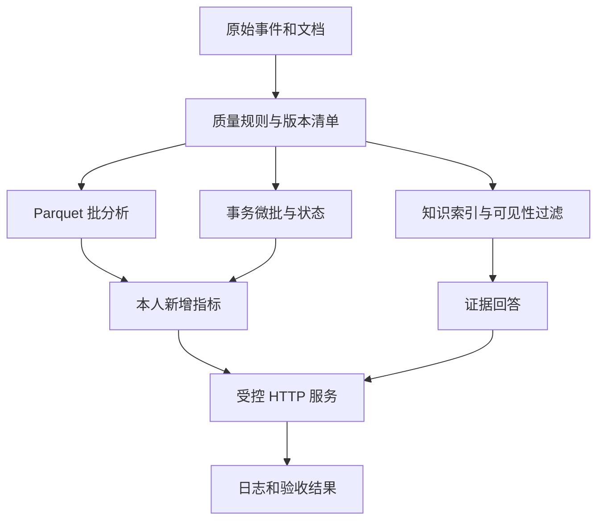

# 两周个人综合项目：方案与实现手册

本手册帮助你把前八次实验组织成一个可以解释、重建和验收的个人项目。目标不是从零重装全部技术，而是在已理解的管线上完成两项有因果关系的独立改动。完整范围、工作量与评分见 [项目任务书](项目任务书.md)。

手册中的 `coursekit` 命令是课程包已有命令，可以复制运行。`project/` 下的功能需要你实现，并在 README 中写出真实入口。完成前八次实验后再进入本项目。

## 1. 先写一个能验证的用户故事

用下面的句式写三句话：

> 作为【某个具体用户】，我想在【一种具体情境】下得到【可观察结果】，以便【一个决策】。
> 系统输入是【数据与请求】，输出是【统计、证据、版本或拒绝理由】。
> 我将用【一组预先约定的数据和检查】证明它正确。

例如，方向 A 可以是：“作为校园公共计算资源管理员，我想查询今天哪个服务的失败率超过阈值，并看到对应处置规则，便于人工排查。系统读取合成服务事件和规则文档，输出服务统计、计算方法、引用和数据版本。用 10 条可手算事件以及一份重复/中断序列检查。”这段只展示用户故事的写法；你的方案应替换为本人实际实现的输入和结果。

把“智能平台、海量数据、全自动 Agent”改成具体输入和结果。若无法写出一条固定请求及其应返回的字段，需求还不够明确。

## 2. 确认基础环境与保留基线

所有命令在 Windows PowerShell、课程根目录运行。以下采用课程统一示例位置 `C:\BDP`；如果目录不同，仅修改第一行，后面使用相对路径。

```powershell
Set-Location 'C:\BDP'
.\.venv\Scripts\python.exe --version
.\.venv\Scripts\python.exe -m coursekit --help
Get-ChildItem -LiteralPath '.\data\silver'
Get-ChildItem -LiteralPath '.\outputs'
```

第一行选择包含 `coursekit` 的目录。第二行确认使用课程虚拟环境，而不是另一套全局 Python。第三行确认命令入口存在。后两行检查前八次实验的产物；如果 `silver` 不存在，先回到实验 2 生成有效数据，再继续项目。

开始修改前，把当前可运行的课程包保存为一份只用于恢复的副本，或创建本地 Git 基线。使用 Git 时先确认这个目录确实属于自己的项目，不要在他人的共享目录提交数据。

```powershell
git status --short
```

如果目录还不是 Git 仓库，本命令会报错；这不妨碍项目。可用普通备份和修改对照表，不能因没装 Git 阻塞后续。已有 Git 时按学校仓库规则提交；不要将 `.venv`、模型、秘密配置或全部大型产物加入版本控制。

创建本人项目子目录，命令仅创建不存在的目录，不删除已有文件：

```powershell
$projectFolders = @('.\project', '.\project\data', '.\project\tests', '.\project\config', '.\evidence', '.\diff')
foreach ($projectFolder in $projectFolders) {
    New-Item -ItemType Directory -Path $projectFolder -Force | Out-Null
}
```

`project/data` 放本人边界数据和预期答案；`project/tests` 放验收逻辑；`project/config` 放阈值等参数；`evidence` 保存实际结果；`diff` 保留本人改动。基础原始数据继续位于课程 `data/raw`，两者职责不要混淆。

## 3. 整体方案如何写到可实现

### 3.1 模块图需要表达数据流

可以从下面的职责图删减和改写。每个箭头旁补上你实际传递的文件、表或 HTTP 数据；不要只画框架 Logo。



对每个框回答四个问题：谁负责；输入是什么；改变什么持久状态；失败怎样被发现。模块没有明确输出时，往往说明设计过大或职责混杂。

### 3.2 数据契约要落实到字段

在 `项目方案.md` 中建立表格，不只写“使用 JSON 数据”。示例主事件契约如下，可在保持课程兼容字段的基础上扩展：

| 字段 | 类型 | 约束与用途 | 异常策略 |
|---|---|---|---|
| `event_id` | 字符串 | 稳定业务 ID；重试不换 ID | 缺失拒绝，重复不重复生效 |
| `event_time` | ISO8601 UTC 字符串 | 事件发生时间，区别于文件读取时间 | 无法解析隔离；晚到按书面策略处理 |
| `service` | 枚举字符串 | 作为分组和固定查询条件 | 不在允许列表时拒绝或隔离 |
| `input_tokens/output_tokens` | 非负整数 | 用量指标；不是字数 | 负数、缺失、类型错误隔离 |
| `latency_ms` | 非负整数 | 本次事件记录的服务耗时 | 与 HTTP 测试端到端耗时分开 |
| `status` | 枚举字符串 | 成功/错误判定 | 未知值应拒绝或隔离 |

政策文档另写 `doc_id/version/visibility/updated_at/text` 以及撤回的表达。清楚区分“某文档第 2 版”和“整个数据集快照 2”：前者属于内容，后者固定一次实验使用的所有输入。

### 3.3 模拟成本的正确写法

若选择成本方向，由本人声明模拟单价，例如每百万输入 token 的价格 `p_in`、每百万输出 token 的价格 `p_out`。按公式计算：

```text
estimated_cost = input_tokens / 1_000_000 × p_in
               + output_tokens / 1_000_000 × p_out
```

这是课堂模拟费用，不是任何厂商账单。配置文件记录货币单位、单价来源（“课程假设”即可）、生效版本；输出记录该配置版本。不要把两个模型档位相加后再乘同一个单价。用极小样本手算两条记录，再核对程序。

### 3.4 写出两项本人改动的联动

示例：“新增每个服务的失败率计算 → 新增只读查询返回超过阈值的服务和对应政策”。第一项产生新数据，第二项使用户消费它。

```text
改动一：
  问题与理由：
  文件/函数：
  输入、输出与状态：
  算法/规则：
  手算或参照结果：

改动二：
  为什么依赖改动一：
  文件/接口：
  参数、权限与版本：
  用户可见结果：
  失败与验收方法：
```

别把“增加日志”和“修改 README”当成两项核心改动；它们通常是交付支撑。也不要一次增加五个数据库。能完整解释一个业务闭环比列出许多未完成特性更好。

## 4. 第 3—4 天先跑通最小完整路径

下面用于复核已有课程基线。已经得到有效产物时，不必每条重跑；先检查版本，选择缺失阶段恢复。`seed` 用于生成课程基线，发现既有原始事件与本次生成内容不同会拒绝覆盖；修改了本人数据后应保留原数据，不绕过保护重新生成。

```powershell
.\.venv\Scripts\python.exe -m coursekit identity --student-id 20260001 --lab 09 --stage start
.\.venv\Scripts\python.exe -m coursekit lab02
.\.venv\Scripts\python.exe -m coursekit lab04
.\.venv\Scripts\python.exe -m coursekit lab05 --mode lexical
.\.venv\Scripts\python.exe -m coursekit lab06 --split dev --generator extractive
```

先把示例学号替换为本人学号。`lab02` 形成合法唯一 Parquet 与清单；`lab04` 形成增量状态与增量服务汇总；`lab05` 建立基础词法索引；`lab06` 在开发题目上运行证据摘录。它们帮助确认环境和主线，尚不算本人项目的新增功能。

打开第二个 PowerShell 窗口，进入同一目录，启动已有 HTTP 服务：

```powershell
Set-Location 'C:\BDP'
.\.venv\Scripts\python.exe -m uvicorn coursekit.service:app --host 127.0.0.1 --port 8000
```

这个窗口被服务占用是正常现象；保留窗口，结束时按 `Ctrl+C`。如果端口被占用，先检查是否已有本人启动的同一服务，不要结束不明进程。基础验收命令使用固定端口 8000，因此不要只修改启动端口却忘记客户端。

回到第一个窗口发送真实请求。查询正文示例应按你当前的文档内容改写，不依靠一个问题“碰巧命中”判断系统有效：

```powershell
Invoke-RestMethod -Uri 'http://127.0.0.1:8000/health' | ConvertTo-Json -Depth 8
Invoke-RestMethod -Uri 'http://127.0.0.1:8000/stats' | ConvertTo-Json -Depth 10
$projectRequest = @{ question = '平台的公开使用规则是什么？'; role = 'public' } | ConvertTo-Json
$projectBytes = [System.Text.Encoding]::UTF8.GetBytes($projectRequest)
Invoke-RestMethod -Method Post -Uri 'http://127.0.0.1:8000/ask' -ContentType 'application/json; charset=utf-8' -Body $projectBytes | ConvertTo-Json -Depth 12
```

显式转换为 UTF-8 字节可以减少不同 PowerShell 版本对中文请求体处理的差异。每条响应单独转换为 JSON，避免 PowerShell 将结构不同的对象套用同一张表而隐藏字段。`health` 只说明服务当前可用，不能替代业务正确性；`stats` 应对应实验 4 的统计；`ask` 的引用应能回到当前有效文档。

把一次请求及响应保存到 `evidence`，然后让新功能也走到真实接口。可以复用现有服务并增加一条受控路由，也可以在 `project` 内写自己的应用。若新增自己的启动命令，必须在 README 标明真实模块路径，并在干净目录执行验证；不要继续写课程服务地址却展示另一套程序结果。

## 5. 独立实现应如何推进

### 5.1 先从 8—20 条小数据开始

本人创建小数据，至少包含：正常记录、同 ID 重复、数值非法、跨服务记录、乱序/晚到记录。先写预期结果，再执行。

以失败率为例，某服务 5 条唯一事件中 1 条失败，失败率为 `1/5`；将其中一条完整重复投递，分子分母都不应增加。若系统把重复请求算入，就可能错误得到 `1/6` 或 `2/6`。具体原始输入是什么、重复哪条，必须在自己的验收数据中固定。

不要用实现函数自己生成“期望值”再与自己比较。小数据手算、独立 SQL、简单串行参照，都可以成为不同于核心实现的参照路径。

### 5.2 再扩展到较大数据比较

复用课程 Parquet 与 Dask 路径，保持输入不变，只改 workers 或 partitions。先检查聚合结果一致，再比较时间。至少写清：

- 计时包含哪些阶段，是否包含启动进程或读文件。
- 运行次数、第一次冷启动与后续运行是否混合。
- 数据行数和字节数、处理列、分区数量。
- 单机 CPU/内存及其他重负载是否关闭。
- 结果更慢时，调度或序列化开销是否足以解释。

不要为了“证明并行快”而给串行路径加等待，也不要把不同数据规模的两个时间直接比较。性能结论应只覆盖你测试的配置。

### 5.3 做真实的受控失败

选择事务提交前中断作为基础故障：事件尚未提交时触发失败，恢复后从持久状态重读。观察数据表和检查点是否一起回滚。然后再次输入重复数据，确认业务结果不增加。

若本人新增的输出在数据库事务之外，例如单独写 JSON 文件，解释这个输出怎样与数据库状态一致。可以在事务提交后从数据库重新生成派生文件；不要把“事务保护了 SQLite”扩张为“所有外部文件都自动原子”。

计划故障应限制在本人实验目录和程序逻辑，不结束系统服务、不切断整个网络、不损坏原始数据。失败输出保留原文，不用截图中的红色文字多少评价严重程度。

### 5.4 建立问答与权限验收

本人建立至少 12 个验收项。推荐每项包含：

```text
case_id:
question:
role: public 或 internal
data_version:
relevant_doc_ids:
answerable: true 或 false
expected_behavior:
why: 人工依据与原文位置
split: dev 或 test
```

先人工确认相关文档，允许多篇相关。索引变化后用固定题目测影响，不能自动替换相关性标签以迎合结果。最终测试集在第 11 天冻结；如果后续发现标签错误，应记录纠正原因，再重新报告所有受影响结果。

对引用检查分三步：引用 ID 存在；当前角色能访问且该版本有效；答案中的实际说法被证据支持。前两步可以自动化，第三步仍需人工核对；不要将 `citation_valid=true` 当成事实正确的充分条件。

### 5.5 选择一条完整的检索与回答路径

模型路径使用已按清单校验的固定 BGE 与 Qwen3.5 0.8B Q8_0，在相同数据和问题上运行：

```powershell
.\.venv\Scripts\python.exe -m coursekit lab05 --mode semantic
.\.venv\Scripts\python.exe -m coursekit lab06 --split dev --generator ollama
```

先按实验 5/6 手册安装模型依赖并核对 manifest、模型 tag 与服务，再执行上述命令。命令失败时保存错误；切换基础路径后，结果文件应标明最终使用的检索器和生成器。模型路径记录模型 ID、revision、硬件、耗时、输出长度与逐题结果。

基础路径须完成一种关键词排序、一个第二组查询/排序变式、确定式摘录规则的关键边界修改，以及同一验收集的逐题来源与拒答核对。它与模型路径分值相同。无论选择哪条路径，更高相似度只表示当前方法下更接近，还要核对权限、版本和原文；检索/回答也不能代替数据质量、故障恢复与服务验收。

## 6. 把验收写成可以重复执行的契约

项目可以在 `project/tests` 中编写自己的验证脚本或测试。README 写出你实际实现的调用命令，不使用不存在的 `coursekit project` 命令。至少覆盖下表：

| 编号 | 输入/动作 | 应观察到什么 | 必须保留的证据 |
|---|---|---|---|
| V01 | 加载可手算小数据 | 合法唯一数与人工表一致，非法项有去向 | 输入、人工表、质量结果 |
| V02 | 批处理与独立参照 | 关键聚合相等，允许明确的浮点误差 | 两种结果与误差范围 |
| V03 | 相同事件再次输入 | 业务结果不重复生效 | 首次/重放记录与状态 |
| V04 | 提交前注入故障后恢复 | 未提交数据/检查点回滚，恢复结果与无故障参照一致 | 故障、恢复、参照 |
| V05 | 一条晚到数据 | 按方案更新或隔离，有明确理由 | 时间线、策略和结果 |
| V06 | 固定问答验收集 | 可回答、拒答分组分别统计；引用逐题可查 | 问题、标签、逐项输出 |
| V07 | public 查询内部材料 | 内部内容不进入结果或证据 | 原材料可见性与响应 |
| V08 | 文档撤回/版本变化 | 旧索引被拒绝或重建；旧内容不继续从缓存出现 | 清单变化、拒绝/刷新、复验 |
| V09 | 真实 HTTP 请求与负载 | 返回符合契约；记录失败、延迟与吞吐 | 请求、响应、20 请求以上结果 |
| V10 | 新目录重建 | 根据 README 重新产生主要结果 | 环境、命令、散列/关键不变量 |

V03 不能只比较同一份未变化的旧文件；要证明处理器确实读取了重复输入。V08 不能只把 `version=2` 写进响应；需要真实核验清单或索引。V10 不要求你复制整个虚拟环境，应按依赖文件重新安装或使用学校提供的离线包。

## 7. 服务测量与报告

现有课程服务仍运行时，可以先复用课程负载作为基线：

```powershell
.\.venv\Scripts\python.exe -m coursekit lab07 --requests 20
Invoke-RestMethod -Uri 'http://127.0.0.1:8000/metrics' | ConvertTo-Json -Depth 8
```

本人新增接口需要对应的负载客户端，测试结果应来自这个新接口。报告固定请求集、重复次数、缓存是否预热、成功/失败数、延迟 p50/p95 和吞吐量计算方式。20 条请求足以验证测量链路，但不是生产容量预测；小样本 p95 对个别慢请求很敏感，应保留原始样本。

成本方向额外写：输入/输出用量、模拟单价、总估算和版本。没有真实云调用时，真实 API 费用写“未发生”；本地 CPU 时间另列为运行耗时。

## 8. 交付 README 的最小完整内容

建议按以下顺序书写，每段用本人已经验证过的路径和命令替换说明文字：

1. 项目解决的问题与当前已完成范围。
2. Windows、Python、CPU/内存要求；选择模型路径时的默认制品准备；哪些依赖为选做。
3. 解压后的目录位置与安装依赖的命令。
4. 生成/取得输入的方法，种子与散列；是否会覆盖数据。
5. 构建数据与索引的命令；每步成功判断。
6. 服务启动命令、端口、健康检查；如何正常停止。
7. 一条完整 HTTP 请求及预期字段。
8. 全部验收命令和结果位置。
9. 两项本人改动及其 diff。
10. 已知限制与恢复方法；使用 AI 助手者注明记录位置。

端口占用、模型缺失、旧索引和非法数据至少给出与本人实现一致的说明。不要建议“删除所有文件重新来”，因为这会破坏版本和恢复证据。

## 9. 干净目录复建与最终核对

第 13 天从最终交付包解压到新的本人目录，按 README 一行一行运行。旧目录中的模型、数据库、绝对路径或未提交模块不属于交付包。模型步骤如依赖另行取得的离线模型目录，应清楚列出该前提；基础路径仍应可独立复建，无法在复建机运行的模型项记录实际原因。

复建时数值与散列的判断要合理：固定输入的散列、唯一记录数和逻辑聚合可严格检查；运行时间、生成文本或某些带时间戳的输出散列可以变化。报告说明哪些产物可字节重现，哪些只要求语义不变量。

最后用 3—5 分钟演示按顺序展示：用户请求与真实响应；一项本人核心改动；一次重复或权限/版本边界；对应的日志与证据。口头解释不要朗读整份报告，重点回答“为什么这个结果可信”。
