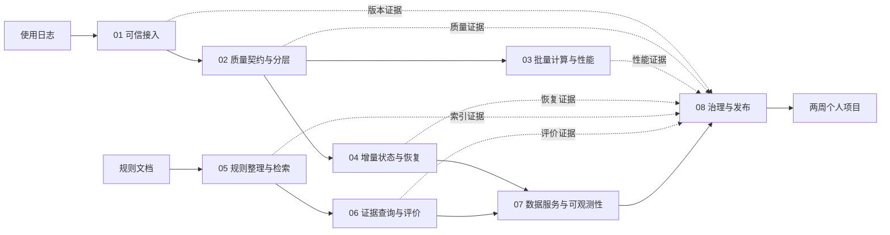

# 《云计算与大数据处理》实验课程总体设计方案

面向计算机专业本科生。实验课内共 32 学时，按 1 学时 45 分钟计算，编排为 8 次 × 180 分钟；第九项是课外两周个人综合项目，预计投入 20—30 小时，不挤占前 32 学时。若本校每学时为 50 分钟，每次增加的 20 分钟用于复核和讨论。

本方案采用 [AID](https://gitee.com/ryukinkou/AID) 的 Windows、CPU、16 GB 与渐进实验编排，借鉴 [MSD](https://gitee.com/ryukinkou/MSD) 的真实运行证据、失败修复和个人交付规则。实际参考文件及转化过程见 [参考材料分析](research/reference-analysis.md)。技术取舍由 [官方证据与选型说明](research/technology-evidence.md) 支撑，核实日期为 2026-09-11；“前沿”不等于要求学生安装当日最新版本。

课程从 [课程导论与课前准备](<../00. 课程导论与准备/课程导论.md>) 开始。导论用管理员、学生和维护者的具体任务拼出全景，占实验 01 前 45—50 分钟，不另增课时；依赖和模型下载在课前完成。

## 1. 课程要培养的能力

完成课程后，学生应能解释并实现一个小型数据产品的完整路径：原始数据怎样被可靠接收，怎样证明清洗正确，何时值得并行，增量更新失败后怎样恢复，规则怎样变成可检索证据，服务怎样暴露统计与查询能力，最后怎样根据质量、权限、可靠性和资源证据决定能否发布。

课程面向计算机科班、无大数据开发经验且编码能力偏弱的本科生，不把 Python、SQL 的熟练程度当作未经确认的事实。课前小测后可补字典、函数、文件读写、`SELECT/WHERE/GROUP BY` 与主键小练习。每章采用“小数据预测—运行脚手架—核对关键字段—补全关键局部逻辑—变式验证”，不要求学生从空白搭建整套平台。

### 1.1 可评价的课程目标

| 目标 | 完成课程后能够做什么 | 直接证据 |
|---|---|---|
| C1 数据与云接口 | 用对象键和清单管理输入，解释计算与存储职责，验证传输完整性 | 源文件与下载文件散列一致，能指出模拟服务与真实云的差别 |
| C2 大数据计算 | 建立数据契约、列式产物和分区处理，比较串行与进程执行 | 质量报告、Parquet、执行计划、Dask 与 DuckDB 结果对照 |
| C3 可靠增量更新 | 对重复、非法、晚到事件与中断给出明确策略 | 首次处理、重放、回滚、恢复的状态与结果证据 |
| C4 规则证据供给 | 为检索、摘录和可选生成提供可追溯、可过滤、可评价的数据 | 文档/索引版本、相关性标签、逐题证据、拒答案例 |
| C5 服务与治理 | 发布可调用接口并测试数据版本、权限、性能和失败行为 | HTTP 请求、延迟分位数、日志、缓存键、发布检查 |
| C6 独立工程判断 | 无论是否使用 AI 助手，都能证明关键决策正确 | 本人先行预测、核心规则修改 diff、失败分析、现场变式 |

### 1.2 AI 是应用背景和自愿实践，不是课程前提

AI 基础设施不只是模型文件和 GPU。训练需要去重、许可与切分正确的数据；检索需要最新且带来源的知识；推理需要可度量的请求与资源记录；Agent 需要受控工具返回结构化、可核验的数据。四类消费方式共享数据质量、权限、版本和可观测性要求。

本课直接实现的是使用日志分析、规则检索、证据查询和数据服务。实验 05、06 保留固定 BGE 与本地 Qwen 的完整实践，也保留无需模型的词法/摘录基础路径；两条路径同等满足必达目标。学生 AI 助手和系统模型均自愿，课程不安排训练基础模型，也不把八次实验改成提示词练习。

## 2. 统一案例与技术边界

统一案例为“校园公共计算资源使用分析与规则查询平台”。数据均为教师自制的虚构数据：学生不处理真实账号、真实学生日志、私人对话或付费调用账单。现有推理事件只是数字服务工作负载的一类实例，生成数据不调用真实模型。

平台接收三个服务 `assistant/search/batch` 的推理事件。每条事件包含稳定 `event_id`、UTC 时间、服务、模型档位、输入输出 token、耗时和状态。默认输入为 20,000 条合法唯一记录、100 条完全重复记录、2 条非法记录，共 20,102 行。政策文档包含不同版本、公开/内部范围、撤回信息与一条不可信注入样例；问题集合预先区分开发集和最终验收集。

八次实验使用同一课程目录，产物沿使用日志与规则文档两条主线累积，并在服务与发布阶段汇合。不要每次重新生成数据或清空整个 `data` 目录。学生先保留基线，再做隔离的对照修改；每次提交保留身份信息、配置、版本与结果。

实验 03 不直接把性能表交给实验 05。实验 05 的检索内容来自规则文档；当前实现只把实验 04 统计快照哈希纳入索引清单，作为跨主线版本标记。实验 04 的增量汇总与实验 06 的规则证据服务在实验 07 汇合；实验 08 汇总各层版本和验收证据。交叉虚线表示证据依赖，不冒充内容输入。

### 2.1 默认栈与诚实边界

| 层次 | 本课实际使用 | 学生能观察的机制 | 不能据此声称 |
|---|---|---|---|
| 云数据接口 | Moto S3 HTTP + boto3 | bucket/key、endpoint、上传下载、内容散列 | 已部署公有云、已验证云耐久性或生产 IAM；临时 Moto 停止后不保留云侧状态 |
| 数据存储与分析 | JSONL、Parquet、DuckDB | 类型、去重、列式存储、分区、聚合、清单 | 已部署完整分布式湖仓或实现 Iceberg 全部事务 |
| 并行计算 | Dask LocalCluster，独立 worker 进程 | 调度、分区映射、聚合、序列化、并行开销 | 已验证多机网络或机房级故障；它是真进程执行，不是循环模拟 |
| 增量更新 | SQLite 主键、事务和检查点 | 重放幂等、提交前失败回滚、恢复、晚到处理 | 已部署 Kafka/Flink 流集群或获得所有外部系统的端到端 exactly-once |
| 规则检索基础路径 | 字符 TF-IDF/BM25 与权限、版本过滤 | 可复算表示、来源、排名、检索评价 | TF-IDF 是语义 embedding |
| 证据查询基础路径 | 引用原文的确定式摘录 | 检索、证据组装、拒答、引用检查、评价闭环 | 摘录等于调用 LLM；引用存在就等于完全忠实 |
| 自愿本地模型路径 | 固定 BGE；Qwen3.5 0.8B Q8_0 本地生成 | 真实 embedding、模型调用、语义/生成与基础路径对照 | 不运行就不能完成课程；模型回答流畅就可发布 |
| 服务与工具 | FastAPI/Uvicorn、本机 HTTP、固定统计查询 | 服务边界、缓存、请求负载、只读工具能力 | 已获得公网生产安全；请求中的 `role` 字段不是身份认证系统 |

实验 05 的本地模型路径为“词法基线 → 固定 BGE → 词法/语义对照”；实验 06 为“原文摘录 → 默认本地 Qwen → 引用与依据对照”。它们是保留的完整实践，不是付费服务前提。选择基础路径的学生无需标 `SKIP` 或分析教师模型输出，也可满分；选择模型路径者必须提交真实身份、调用与逐题证据。在线付费 API 由学生本人自主决定，课程不指定也不收集密钥。

### 2.2 环境与费用

统一采用 Windows 11 64 位、Python 3.12、普通 CPU、16 GB 内存。基础路径不要求 Docker、模型、GPU 或外部 API 密钥；选择本地模型路径者在课前准备固定 BGE 与 Qwen，课堂只做短健康检查。全部实验默认本机回环地址，数据保留在自己的课程目录。

环境、模型和个人副本建议预留至少 8 GB 可用空间，扩大数据规模另计；教师应在下载清单列出实际模型与运行时大小并预留余量。资源数字是规划预算，应由教师在参考机验收，不能当作所有电脑的运行保证。选择基础路径的学生按相同概念和工作量评价，并保留个人实测覆盖范围。

## 3. 八次实验的递进矩阵

| 次序与 4 学时主题 | 先修与读取产物 | 本次新增知识；累计能力 | 交接产物 | 必须本人完成；AI 允许辅助 |
|---|---|---|---|---|
| 01 云端数据接口与可复现环境 | 课前按需复习 Python/SQL；无前次产物 | JSONL、HTTP 对象接口、环境隔离、散列、可复现输入；形成可信起点 | 原始事件/文档/题目、身份文件、传输校验记录 | 先解释对象键与本地路径、预测散列；AI 可协助环境报错和 SDK 语法 |
| 02 数据湖与质量契约 | 01 原始事件和散列 | 数据类型、非法值、主键、去重、列式存储、清单；形成可信分析数据 | `data/silver/events.parquet`、质量报告、silver 清单、每日服务汇总 | 先写去重键和质量规则，亲改一项规则；AI 可审查 SQL 与提出反例 |
| 03 分布式批处理与性能分析 | 02 合法 Parquet；01—02 版本和质量 | 进程 worker、任务图、分区、局部/全局聚合、开销；解释何时并行 | Dask/DuckDB 正确性对照、不同 workers/partitions 性能记录 | 手算局部聚合如何合并，改变分区做受控比较；AI 可解释任务调度日志 |
| 04 增量事件处理与故障恢复 | 02 数据契约；03 分批与计算代价 | 事件时间/处理顺序、主键幂等、检查点、事务；批转增量 | SQLite 状态、重放/失败/恢复证据、增量服务汇总 | 先推演重复和中断结果，修改晚到/批量策略；AI 可协助定位 SQL 错误 |
| 05 规则文档整理与可解释检索 | 01 文档；04 增量汇总用于版本血缘 | 版本、权限、词法检索；自愿完成 BGE 语义对照 | 索引/清单、Top-K 来源、过滤案例 | 小排名预测，补全一段排序或过滤逻辑；AI 助手可选 |
| 06 证据查询与结果评价 | 05 索引与文档 | 拒答、引用、Recall@k、dev/test；自愿完成 Qwen 生成对照 | 摘录/生成结果、冻结测试、失败题目 | 手算一个指标，补全证据选择逻辑；AI 助手可选 |
| 07 数据服务部署与可观测性 | 04 增量汇总、06 查询函数 | HTTP、结构化统计、版本化缓存、延迟/错误 | HTTP 负载、日志、统计接口 | 预测缓存影响，补全一项固定接口规则；AI 助手可选 |
| 08 数据治理与可信发布 | 01—07 全链路和证据 | 权限过滤、提示注入数据边界、撤回/失效、旧索引检查、发布门槛 | 发布检查、攻击/恢复案例、全链路交付包 | 本人解释一个越权/旧版本失败并做变式；AI 可审查遗漏项，不能生成虚假 PASS |

### 3.1 每次 180 分钟如何分配

时间表包含个人预测、真实执行、独立修改和证据整理。教师将详细操作落实到对应实验手册，不把所有时间用于跟敲代码。

| 次序 | 0—20 分钟 | 20—50 分钟 | 50—105 分钟 | 105—145 分钟 | 145—165 分钟 | 165—180 分钟 |
|---|---|---|---|---|---|---|
| 01 | 场景、目录、课前预检复核 | bucket/key/散列最小例 | 生成输入、S3 HTTP 往返 | 对照对象键与错误 endpoint | 独立预测与解释 | 身份/散列证据与交接 |
| 02 | 读取 01 清单 | 质量规则与重复手算 | 清洗、Parquet、汇总 | 独立改规则并比较影响 | 非法数据隔离与复验 | 保存质量/版本证据 |
| 03 | 读取 02 可信数据 | 分区聚合与任务图 | 1/2 workers 执行和对照 | 改分区数、解释开销 | 校验错误聚合反例 | 性能表与结论 |
| 04 | 核对批数据统计 | 重放、事务、检查点推演 | 首次处理/重放/故障/恢复 | 独立修改与晚到处理 | 状态一致性复核 | 恢复记录与交接 |
| 05 | 回看版本与权限 | 小排名例 | 词法基础路径 | 本地 BGE 路径或基础变式 | 错误检索分析 | 索引和评估证据 |
| 06 | 核对索引与 split | 指标手算与拒答 | 摘录与 dev 评价 | 本地 Qwen 路径或基础变式 | 冻结后 test | 逐题结果与限制 |
| 07 | 读取增量统计与索引 | HTTP/缓存/指标预测 | 启服务、请求、真实负载 | 改缓存/负载并比较 | 错误、版本与日志复核 | 服务证据与交接 |
| 08 | 复核完整链路 | 威胁/版本/发布规则 | 权限、注入、过期检查 | 独立变式与恢复 | 发布检查和口头抽查 | 归档与项目衔接 |

每行合计 20 + 30 + 55 + 40 + 20 + 15 = 180 分钟。基础报告以课堂证据为主体，课后只需整理，不另塞大段必做开发。选做扩展可以课后进行，不能影响后续必做实验。

## 4. AI 使用规则与独立学习设计

AI 助手使用采用三层边界，并在每份手册用一句话重申；未使用者不必提交空白记录。

**可以辅助：** 解释库 API、定位环境错误、产生额外测试、审查代码、润色本人已经写下的结果。学生必须记录采用与拒绝的建议并运行验证。

**必须先本人做：** 主键和去重策略、质量规则、事务边界、微型结果预测、指标手算、相关性标签、性能因果解释。先保留自己的答案，再让 AI 提问或质疑。之后的修改要写清原因。

**不可代做或伪造：** AI 替代指定独立代码修改、现场验收、本人观察，或生成没发生的日志/截图/数字/参考资料。不得把 AI 输出直接变成最终测试集答案，或上传真实密钥与私人数据。

每章至少包含两项独立活动：一项先预测再运行；一项修改核心规则或代码并提交 diff。至少一次受控失败必须保留“失败条件—观测—解释—修复—复验”。禁止把“我运行了脚本，看到 PASS”作为完整报告。

报告模板见 [实验报告模板](../报告模板/实验报告模板.md) 与可选的 [AI 使用记录模板](../报告模板/AI使用记录模板.md)。身份码与截图只能关联提交者，不能单独证明原创，需结合代码改动和现场解释。

## 5. 评价设计

建议课程总评采用八次实验平均分 60% + 两周个人项目 40%。八次实验各按 100 分评分；05、06 的模型路径与基础路径使用同一“链路对照与证据分析”评分维度，模型不是额外加分捷径，也不是满分门槛。更大模型、付费 API 和界面增强均为自愿拓展。

八次实验共用评价方向：原理与先行预测、实际执行与数据正确性、独立改动、对照与失败恢复、报告证据。使用 AI 助手者另做简短披露，未使用者不交记录。性能结果没有更快、模型没有更准，都不自动扣分；实验控制正确、结果真实、解释合理才是关键。使用更大的模型却缺乏数据和验收证据，不能代替基础得分。

项目按任务书单独给出 100 分细则，要求一个人在两周内复用已学模块交付可运行 MVP、整体方案和验收数据，不要求搭建一套新的组件平台。项目材料见 [项目任务书](../09.%20两周个人综合项目/项目任务书.md) 与 [项目方案手册](../09.%20两周个人综合项目/项目方案手册.md)。

## 6. 教师如何保证这门课真正可开

教师应在开课前验收无模型基础路径，并只对固定 BGE 与默认 Qwen3.5 0.8B Q8_0 组合做模型发布验收。当前 16 GB、无 GPU 新组合尚未通过，不得沿用旧模型记录冒充。挑战型号由学生自愿探索，不作为教师发布前提；课堂不等待全班下载模型。

逐项检查方法、低配置支持、评分一致性与复核流程见 [教师实施与验收指南](教师实施与验收指南.md)。该指南区分“课程已经提供的功能”和“开课单位仍须做的验收”，不会用技术文档的支持声明替代 Windows 实机结果。
